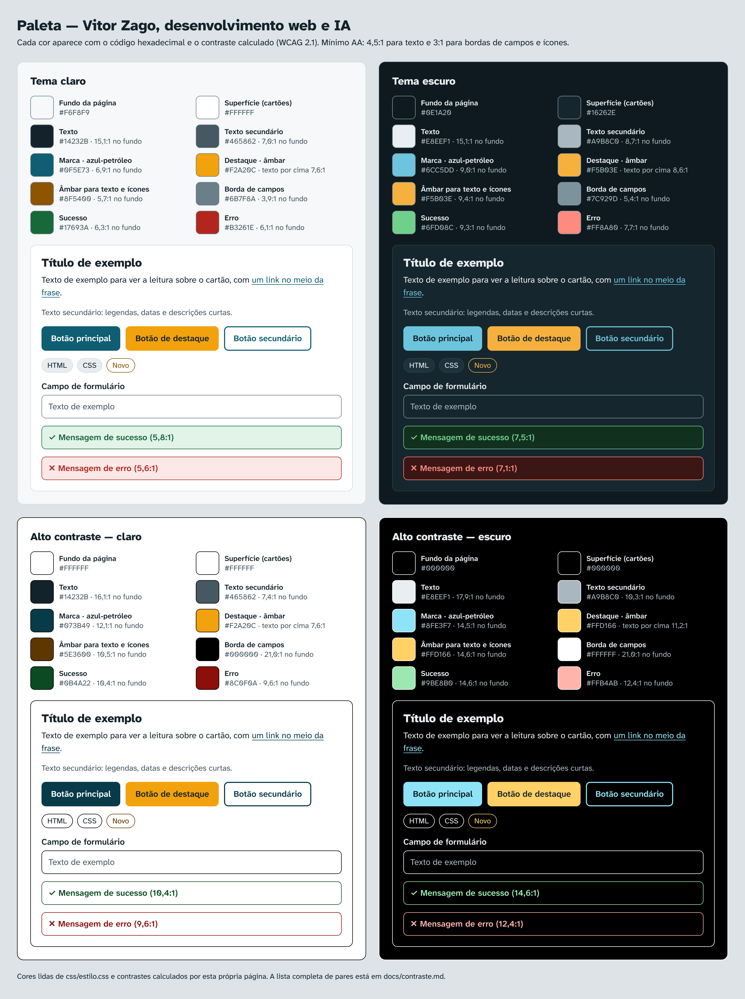

# Cores

> **Situação: paleta aprovada pelo Vitor em 17/11/2026**, com um ajuste: no alto contraste,
> o texto mantém as mesmas cores dos temas claro e escuro.
> As cores estão aplicadas no site como variáveis CSS, em `css/estilo.css` (seções 2 a 4).

Para ver a paleta aplicada em exemplos de interface, abra `docs/paleta.html` no navegador
(a página lê as cores direto do CSS do site) ou veja a imagem abaixo.

## Ideia geral

O site apresenta um desenvolvedor web que também trabalha com IA e que já fez sites para
uma escola de ballet e um escritório de advocacia. A paleta precisa passar duas coisas ao
mesmo tempo: **confiança** (quem contrata quer alguém que entregue) e **iniciativa**
(tecnologia e IA são áreas de novidade).

Por isso a combinação é uma cor fria e séria como base (azul-petróleo) e uma cor quente
usada em pequenas doses para chamar a atenção (âmbar). A proporção segue a regra
60-30-10: cerca de 60% de neutros, 30% de cor de marca e 10% de destaque.

## Paleta

"Contraste" é a razão entre a cor e o fundo da página do mesmo tema, pela fórmula da
WCAG 2.1. Vai de 1:1 (cores iguais) a 21:1 (preto no branco). O mínimo do nível AA é
4,5:1 para texto normal e 3:1 para texto grande, ícones e bordas de campos.

A coluna "Variável" é o nome da cor no CSS.

### Tema claro

| Papel | Variável | Hex | Uso | Contraste |
|-------|----------|-----|-----|-----------|
| Fundo | `--cor-fundo` | `#F6F8F9` | Fundo da página | — |
| Superfície | `--cor-superficie` | `#FFFFFF` | Cartões, campos, cabeçalho, painel | — |
| Superfície 2 | `--cor-superficie-2` | `#E8EDF0` | Rodapé, etiquetas (tags) | — |
| Borda suave | `--cor-borda-suave` | `#D3DBE0` | Linhas divisórias (decorativas) | — |
| Borda de campos | `--cor-borda` | `#6B7F8A` | Contorno de campos e controles | 3,9:1 |
| Texto | `--cor-texto` | `#14232B` | Títulos e texto corrido | 15,1:1 |
| Texto secundário | `--cor-texto-2` | `#465862` | Legendas, descrições, datas | 7,0:1 |
| **Marca** (azul-petróleo) | `--cor-marca` | `#0F5E73` | Links, botão principal, item ativo | 6,9:1 (texto branco por cima: 7,3:1) |
| Marca com o mouse em cima | `--cor-marca-hover` | `#0A4758` | Estado *hover* de links e botões | 9,6:1 |
| **Destaque** (âmbar) | `--cor-destaque` | `#F2A20C` | Fundo do botão de destaque e de selos | texto escuro por cima: 7,6:1 |
| Destaque com o mouse em cima | `--cor-destaque-hover` | `#DE9300` | Estado *hover* do botão de destaque | texto escuro por cima: 6,3:1 |
| Âmbar para texto | `--cor-destaque-texto` | `#8F5400` | Quando o âmbar precisa ser texto ou ícone | 5,7:1 |
| Sucesso | `--cor-sucesso` | `#17693A` | Mensagens de confirmação | 6,3:1 |
| Fundo de sucesso | `--cor-sucesso-fundo` | `#E2F3E8` | Caixa da mensagem de sucesso | — |
| Erro | `--cor-erro` | `#B3261E` | Mensagens de erro, borda de campo inválido | 6,1:1 |
| Fundo de erro | `--cor-erro-fundo` | `#FCE9E7` | Caixa da mensagem de erro | — |
| Foco | `--cor-foco` | `#0F5E73` | Contorno do elemento focado pelo teclado | 6,9:1 |

### Tema escuro

| Papel | Variável | Hex | Uso | Contraste |
|-------|----------|-----|-----|-----------|
| Fundo | `--cor-fundo` | `#0E1A20` | Fundo da página | — |
| Superfície | `--cor-superficie` | `#16262E` | Cartões, campos, cabeçalho, painel | — |
| Superfície 2 | `--cor-superficie-2` | `#1E323C` | Rodapé, etiquetas (tags) | — |
| Borda suave | `--cor-borda-suave` | `#2A404B` | Linhas divisórias (decorativas) | — |
| Borda de campos | `--cor-borda` | `#7C929D` | Contorno de campos e controles | 5,4:1 |
| Texto | `--cor-texto` | `#E8EEF1` | Títulos e texto corrido | 15,1:1 |
| Texto secundário | `--cor-texto-2` | `#A9B8C0` | Legendas, descrições, datas | 8,7:1 |
| **Marca** (azul-petróleo claro) | `--cor-marca` | `#6CC5DD` | Links, botão principal, item ativo | 9,0:1 (texto escuro por cima: 9,0:1) |
| Marca com o mouse em cima | `--cor-marca-hover` | `#93D8EA` | Estado *hover* de links e botões | 11,2:1 |
| **Destaque** (âmbar) | `--cor-destaque` | `#F5B03E` | Botão de destaque, selos | texto escuro por cima: 8,6:1 |
| Destaque com o mouse em cima | `--cor-destaque-hover` | `#FFC766` | Estado *hover* do botão de destaque | texto escuro por cima: 10,4:1 |
| Âmbar para texto | `--cor-destaque-texto` | `#F5B03E` | No escuro o próprio âmbar serve como texto | 9,4:1 |
| Sucesso | `--cor-sucesso` | `#6FD08C` | Mensagens de confirmação | 9,3:1 |
| Fundo de sucesso | `--cor-sucesso-fundo` | `#12301E` | Caixa da mensagem de sucesso | — |
| Erro | `--cor-erro` | `#FF8A80` | Mensagens de erro, borda de campo inválido | 7,7:1 |
| Fundo de erro | `--cor-erro-fundo` | `#3A1614` | Caixa da mensagem de erro | — |
| Foco | `--cor-foco` | `#F5B03E` | Contorno do elemento focado pelo teclado | 9,4:1 |

### Alto contraste

Quando a opção "alto contraste" do painel de acessibilidade está ligada, fundos viram
branco ou preto puros, as bordas ficam fortes e as cores de marca, destaque, sucesso e erro
ganham versões mais intensas. **As cores do texto não mudam**: continuam as do tema claro
ou escuro. Mesmo assim, todo texto passa no nível AAA (7:1 ou mais).

| Papel | Claro | Escuro |
|-------|-------|--------|
| Fundo e superfícies | `#FFFFFF` | `#000000` |
| Bordas (suave e de campos) | `#000000` (21:1) | `#FFFFFF` (21:1) |
| Texto (igual ao tema normal) | `#14232B` (16,1:1) | `#E8EEF1` (17,9:1) |
| Texto secundário (igual ao tema normal) | `#465862` (7,4:1) | `#A9B8C0` (10,3:1) |
| Marca | `#073B49` (12,1:1) | `#8FE3F7` (14,5:1) |
| Marca com o mouse em cima | `#000000` | `#FFFFFF` |
| Destaque (fundo, com texto escuro por cima) | `#F2A20C` (7,6:1) | `#FFD166` (11,2:1) |
| Destaque com o mouse em cima | `#FFC14D` | `#FFE19A` |
| Âmbar para texto | `#5E3600` (10,5:1) | `#FFD166` (14,6:1) |
| Sucesso | `#0B4A22` (10,4:1) | `#9BE8B0` (14,6:1) |
| Erro | `#8C0F0A` (9,6:1) | `#FFB4AB` (12,4:1) |
| Foco | `#000000` (21:1) | `#FFD166` (14,6:1) |

## Justificativa de cada cor

**Marca — azul-petróleo (`#0F5E73` no claro, `#6CC5DD` no escuro).**
O azul é a cor mais associada a confiança, competência e tecnologia; puxado para o verde,
ganha um tom de equilíbrio e crescimento. É um azul mais fechado e calmo que o
roxo ou o azul-elétrico comuns em sites de IA, o que diferencia o portfólio e combina com
quem atende clientes como um escritório de advocacia.

**Destaque — âmbar (`#F2A20C` no claro, `#F5B03E` no escuro).**
Cores quentes transmitem energia, otimismo e criatividade — a "faísca" da ideia nova, que
é o lado de IA do portfólio. Por ser a única cor quente sobre uma base fria, o olho vai
direto a ela; por isso fica reservada à ação mais importante de cada tela.

**Neutros — cinzas levemente azulados (`#F6F8F9`, `#E8EDF0`, `#465862`, `#14232B`).**
Os cinzas têm um pouco do azul da marca, o que deixa o conjunto harmônico em vez de
"cinza de impressora". O fundo é quase branco e o texto é quase preto: mantêm contraste
de 15:1 e cansam menos a vista do que preto puro sobre branco puro.

**Fundo escuro — azul-carvão (`#0E1A20`), não preto puro.**
No tema escuro, texto claro sobre preto absoluto cria um efeito de "halo" que atrapalha a
leitura. Um fundo escuro com um pouco de azul mantém a identidade da marca e é mais
confortável em leituras longas.

**Sucesso — verde (`#17693A` no claro, `#6FD08C` no escuro).**
Verde é a convenção universal de "deu certo, pode seguir" (semáforo). O tom é mais
amarelado que o azul-petróleo da marca, para os dois não serem confundidos.

**Erro — vermelho (`#B3261E` no claro, `#FF8A80` no escuro).**
Vermelho é a convenção de alerta e de "pare": chama atenção imediata para o que precisa
ser corrigido. É um vermelho fechado, legível como texto, sem a agressividade do vermelho puro.

**Alto contraste — branco e preto puros, com o texto dos temas normais.**
Quem liga essa opção precisa de separação máxima entre as áreas da tela; por isso fundos
e bordas vão aos extremos. O texto, porém, mantém o quase-preto e o quase-branco dos temas
normais: a leitura continua confortável e o contraste segue acima de 16:1.

## Regras de uso

1. **O âmbar nunca é texto sobre fundo claro.** `#F2A20C` sobre o fundo claro tem contraste
   de 2,0:1 (reprova). No tema claro ele só aparece como fundo, com texto escuro por cima;
   quando precisa ser texto ou ícone, usa-se o âmbar escuro `#8F5400`.
2. **Cor nunca é o único sinal** (WCAG 1.4.1). Erro e sucesso sempre vêm com ícone e
   texto; link dentro de parágrafo é sublinhado; a página atual no menu fica em negrito e
   sublinhada; a opção escolhida no painel fica preenchida; o interruptor mostra o estado
   pela posição da bolinha.
3. **Um destaque por tela.** O botão âmbar é reservado à ação principal; as outras ações
   usam a cor de marca ou o botão de contorno.
4. **Toda cor nova passa pelo script.** `scripts/contraste.js` lê as cores do CSS e gera
   `docs/contraste.md` com todos os pares texto/fundo usados no site. Ao criar um
   componente com uma combinação nova, o par entra na lista do script.
